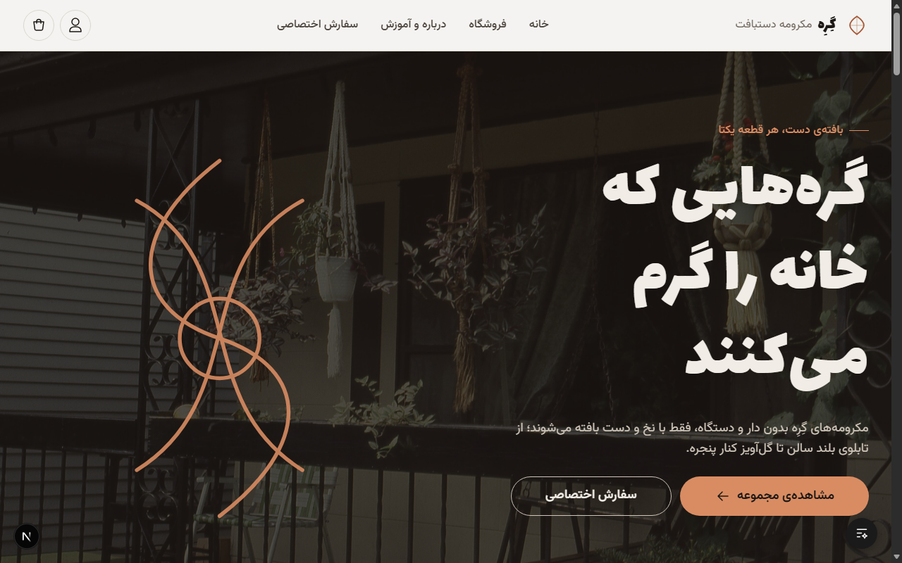
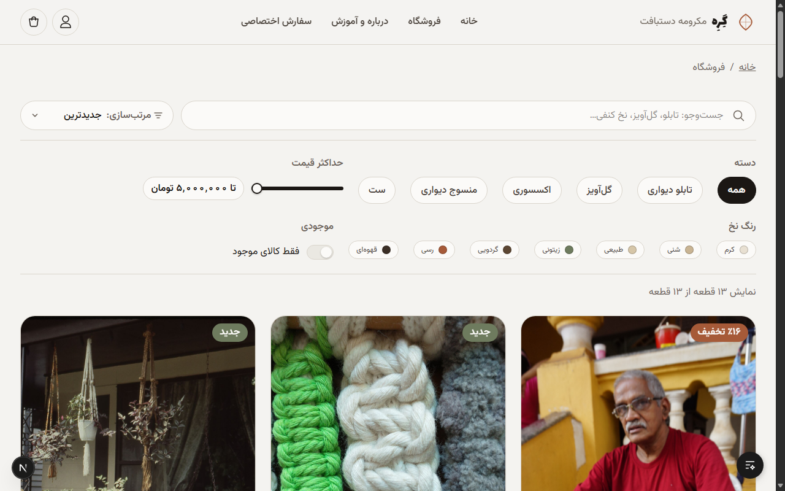
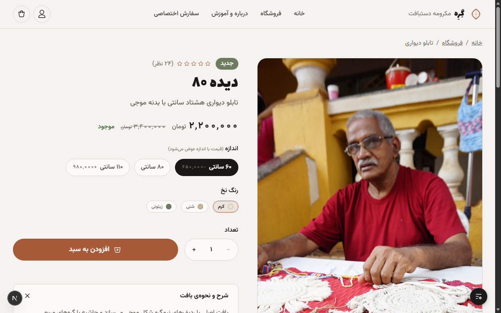
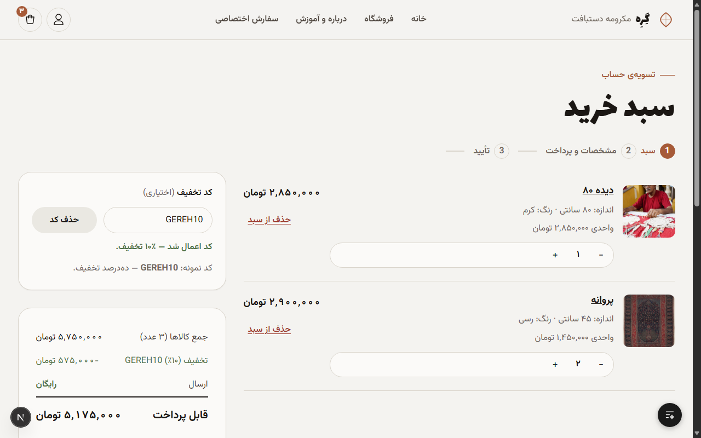
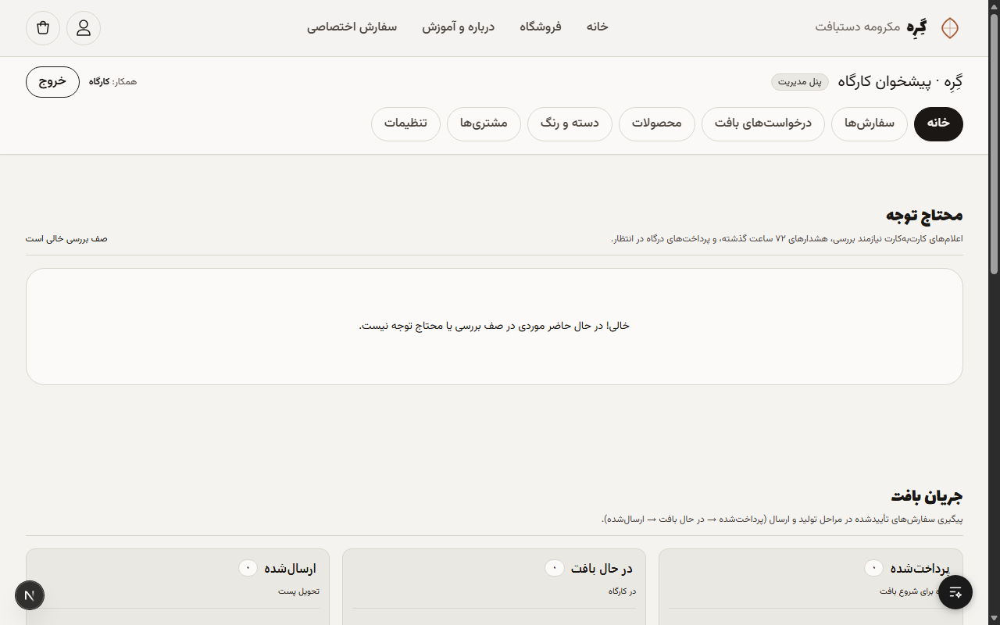
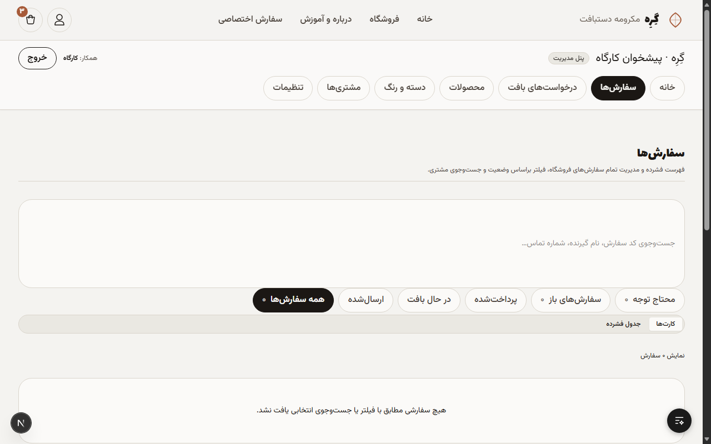
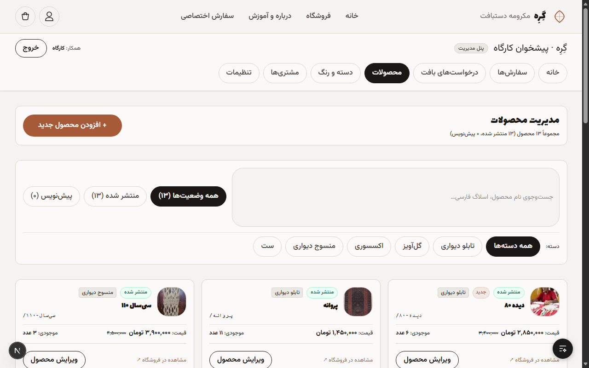
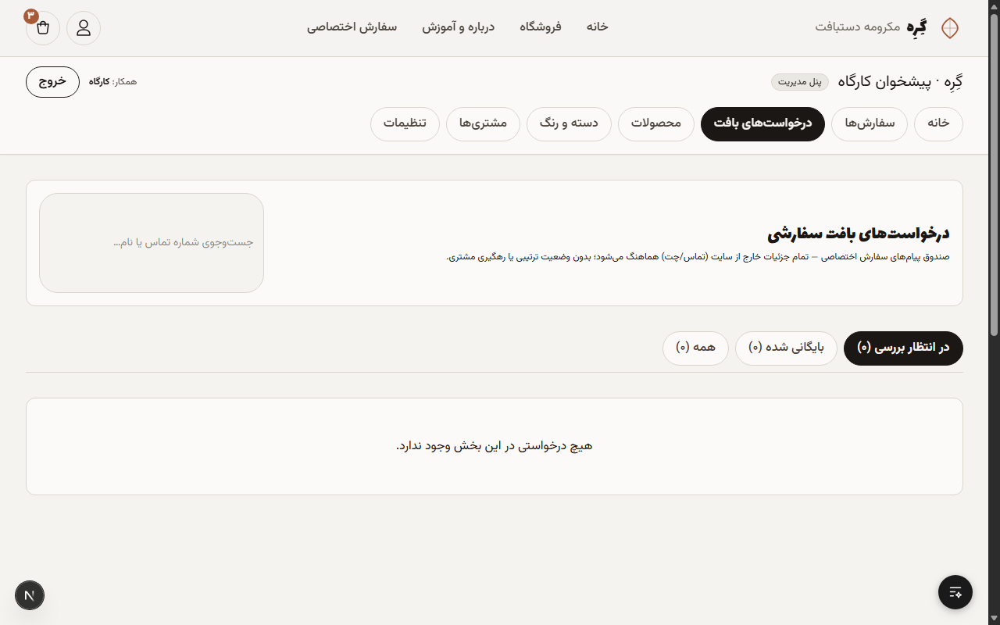

# گِرِه (Gereh) — Macramé E-Commerce Platform

[](https://nextjs.org/)
[](https://react.dev/)
[](https://www.typescriptlang.org/)
[](https://tailwindcss.com/)
[](https://www.sqlite.org/)
[](https://orm.drizzle.team/)

A full-featured, mobile-first, Persian RTL e-commerce platform and staff workshop management system for handcrafted macramé pieces. Built with **Next.js 16 (App Router)**, **React 19**, **Tailwind CSS v4**, and **SQLite via Drizzle ORM**.

Designed specifically for Iranian e-commerce realities: SMS-OTP authentication, integer Toman monetary accounting, dual-payment processing (ZarinPal REST v4 & Card-to-Card transfer audits), and persistent VPS hosting with zero serverless lock-in.

---

## 📸 Visual Showcase

### 🛍️ User Panel (Customer Storefront)

| Home Page | Shop Catalog & Filters |
|:---:|:---:|
|  |  |
| *Editorial hero, Living Knot rope animation, and collection showcases* | *SearchParams filtering, color chips, and dynamic price slider* |

| Product Detail Page | Persistent Cart |
|:---:|:---:|
|  |  |
| *Persian slug routing, color swatches, size deltas, and momentum rail* | *Persistent localStorage lines, quantity steppers, and promo engine* |

---

### 🎛️ Staff Admin Panel

| Attention Queue & Kanban Board | Order Detail & Payment Audit |
|:---:|:---:|
|  |  |
| *«محتاج توجه» attention queue (pending card transfers, 72h-stale) + fulfillment pipeline* | *Line item snapshots, bank declaration trace audit, and tracking code assignment* |

| Catalog & Product Editor | Custom Orders Inbox |
|:---:|:---:|
|  |  |
| *Full catalog CRUD, draft/publish status, image uploads, and size deltas* | *Bespoke commission requests, requirements review, and archiving* |

---

## Highlights & Features

### 🛍️ Customer Storefront
- **Authentic Persian RTL Design**: Custom typography with local Lalezar (headlines) and Vazirmatn (body) fonts — zero external font dependencies.
- **Dynamic Catalog (`/shop`)**: Fast URL-driven filtering via `searchParams` (categories, color swatches, and interactive dual-thumb price slider with live RTL gradient fill).
- **Product Experience (`/product/[slug]`)**: Persian slug routing, image gallery, size delta calculations, interactive color chips, and a momentum-glide related products rail with touch/keyboard navigation.
- **Local Cart (`/cart`)**: Client-side persisted shopping cart (`localStorage`), quantity steppers, stock validation, and promo code verification.
- **Frictionless Checkout (`/checkout`)**: Single-page progressive checkout flow:
  1. Phone verification (SMS OTP)
  2. Delivery address selection or inline creation
  3. Payment gateway selection
- **Order Tracking (`/order/[code]`)**: Track order status using human-friendly 6-character confusable-free codes (omitting `0`, `O`, `1`, `I`). Card-to-card transfer declarations occur directly on this page.
- **Bespoke Inquiries (`/contact#order`)**: Custom order form for made-to-order requests with built-in honeypot spam protection.

### 🛡️ Authentication & Security
- **Invisible Customer Signup**: No traditional password registration. Entering a phone number (`09xxxxxxxxx`) initiates a 6-digit SMS OTP (Kavenegar primary, FarazSMS fallback). Verification automatically registers or logs in the user.
- **Rate-Limited OTP**: Single-use tokens hashed with SHA-256 at rest. Server-side throttle rules: 60s resend, 5/hour and 10/day limits per phone, 20/hour per IP.
- **Staff Authentication**: Secure username and password access protected by **Argon2id** password hashing and brute-force throttling.
- **Session Tokens**: Cryptographically secure 256-bit opaque tokens stored hashed in SQLite with `httpOnly`, `SameSite=Lax` cookies.
- **Next.js 16 Route Guard**: Uses `proxy.ts` (Node.js runtime) at the root level for route protection (`/admin/*`, `/account/*`), deprecating legacy Edge middleware.

### 💳 Payments & Orders Architecture
- **Integer Toman Accounting**: All prices and orders stored in Toman internally; converted to Rial (`Toman × 10`) strictly at gateway boundaries.
- **Dual Payment Channels**:
  - **Online Gateway (ZarinPal v4 REST)**: Server-side payment request and verification with idempotent callback handling (`code 100` first-time settlement, `code 101` already settled).
  - **Card-to-Card (کارت به کارت)**: Manual bank transfer declaration (last 4 digits of source card + optional bank trace code).
- **Order State Machine**:
  ```
  awaiting-payment ──(payment verified)──▶ paid ──▶ in-progress ──▶ shipped ──▶ delivered
        ├─▶ cancelled           (unpaid timeout / customer cancel)
        └─▶ cancelled-refunded  (staff-only before shipped)
  ```
- **Stock Decrement Safety**: Inventory decrements strictly when payment is confirmed (`paid`), preventing inventory reservation denial-of-service.

### 🎛️ Staff Admin Panel (`/admin`)
- **Attention Queue («محتاج توجه»)**: Prioritized view highlighting pending card-to-card payment declarations and stale orders (>72h).
- **Fulfillment Kanban Board**: Real-time fulfillment pipeline: `paid` → `in-progress` → `shipped` (with postal tracking code) → `delivered`.
- **Order Management (`/admin/orders/[id]`)**: Full order detail inspection, price snapshots, address history, manual bank approval/rejection with customer-facing rejection reasons.
- **Catalog Editor (`/admin/products`)**: Product CRUD, draft/published toggling, image uploads via persistent disk (`uploads/`), size variance with price adjustments, and color assignments.
- **Custom Order Inbox (`/admin/custom-orders`)**: Review, filter, archive, or delete customer inquiries.
- **Settings (`/admin/settings`)**: Configurable flat shipping fee, free shipping threshold, active promo code, and contact channels (Phone, Telegram, Instagram, WhatsApp).

---

## Tech Stack

| Layer | Technology | Description |
|---|---|---|
| **Framework** | Next.js 16.3.6 | App Router, React Server Components, Turbopack |
| **Frontend** | React 19.2 + TypeScript 5 | Client & Server Components, Server Actions |
| **Styling** | Tailwind CSS v4 | Local `@theme` tokens, custom warm paper aesthetic |
| **Database** | SQLite (`better-sqlite3`) | Fast, zero-network overhead single file with WAL mode |
| **ORM** | Drizzle ORM 0.45 | Type-safe queries, migrations via Drizzle Kit |
| **Auth** | Custom SMS OTP + Argon2id | Stateless session tokens, brute-force throttling |
| **Payments** | ZarinPal REST API v4 | Online gateway integration + Card-to-Card auditing |
| **Process Manager** | PM2 | Daemon process management for long-running Node service |
| **Web Server** | Nginx / Caddy | Reverse proxy, TLS termination, static asset compression |

---

## Project Structure

```text
aasoo-macrame/
├── app/                        # Next.js App Router
│   ├── (storefront routes)/    # Home (/), /shop, /product/[slug], /cart, /about, /contact
│   ├── account/                # Customer profile, addresses, order history
│   ├── admin/                  # Staff admin panel (orders, products, taxonomy, settings)
│   ├── checkout/               # Checkout wizard & ZarinPal gateway callback
│   ├── order/[code]/           # Public human-friendly order tracker & card declaration
│   ├── uploads/[...path]/      # Static media route handler for persistent uploads
│   ├── globals.css             # Tailwind v4 theme definitions and RTL utility classes
│   └── layout.tsx              # Root HTML shell, local fonts, global header & footer
├── components/                 # Reusable UI components
│   ├── admin/                  # Admin UI (KanbanBoard, AttentionQueue, ProductEditor)
│   ├── checkout/               # CheckoutClient multi-step wizard
│   ├── motion/                 # LivingKnot SVG animation, PageCurtain, RevealObserver
│   ├── product/                # ProductCard, ProductGallery, RelatedProductsRail
│   └── shop/                   # ShopFilterBar, price sliders, collection chips
├── db/                         # Database schema & migrations
│   └── schema.ts               # Drizzle SQLite table definitions & TS union types
├── docs/                       # Project specifications & architecture ADRs
│   ├── screenshots/            # Showcase images for storefront & admin panel
│   ├── SPEC.md                 # Master functional and technical specification
│   ├── DEPLOYMENT.md           # Production deployment & operations runbook
│   └── adr/                    # Architecture Decision Records (0001 - 0005)
├── lib/                        # Core business logic & utilities
│   ├── cart-pricing.ts         # Line pricing, tax/shipping thresholds, promo math
│   ├── db.ts                   # SQLite connection with WAL mode & foreign keys enabled
│   ├── format.ts               # Persian numbers, currency formatting, date helpers
│   ├── phone.ts                # Iranian mobile number normalization & validation
│   ├── reconciliation.ts       # Gateway verification & order sweep routines
│   └── zarinpal/               # ZarinPal v4 REST client & verification logic
├── scripts/                    # Automation & CLI utilities
│   ├── backup.sh               # Online SQLite backup (.backup) & uploads snapshot
│   ├── cron.ts                 # 15-minute background gateway reconciliation sweep
│   ├── seed.ts                 # Idempotent database seeder (initial catalog & staff user)
│   └── take-screenshots.js    # Automated headless browser screenshot pipeline
├── tests/                      # Automated unit & integration tests (Node.js test runner)
├── proxy.ts                    # Next.js 16 request interceptor / route guards
├── drizzle.config.ts           # Drizzle Kit configuration
└── ecosystem.config.cjs        # PM2 process configuration for production
```

---

## Getting Started

### Prerequisites

- **Node.js**: `v20.x` or later (LTS recommended)
- **Package Manager**: `pnpm` (`v9.x` or `v11.x`)
- **SQLite 3**: Bundled via `better-sqlite3`

### 1. Clone & Install

```bash
git clone https://github.com/Abolfazl-Edalati/aasoo-macrame.git
cd aasoo-macrame
pnpm install
```

### 2. Environment Configuration

Copy the example environment file and customize your settings:

```bash
cp .env.example .env
```

Key variables in `.env`:

```env
# Public storefront URL
NEXT_PUBLIC_BASE_URL=http://localhost:3000

# SQLite database path
DATABASE_PATH=gereh.db

# Initial staff user created by seed script
SEED_ADMIN_USERNAME=admin
SEED_ADMIN_PASSWORD=changeme
SEED_ADMIN_DISPLAY_NAME=مدیر کارگاه

# SMS Provider (set SMS_SEND=false for local dev; codes will be logged to server console)
SMS_SEND=false
KAVENEGAR_API_KEY=
FARAZSMS_API_KEY=

# ZarinPal Gateway (Sandbox works with any UUID)
ZARINPAL_MERCHANT_ID=00000000-0000-0000-0000-000000000000
ZARINPAL_BASE_URL=https://sandbox.zarinpal.com
```

> **Note**: In development mode (`SMS_SEND=false`), SMS OTP codes are printed directly to the terminal stdout to facilitate instant testing without spending SMS credits.

### 3. Initialize Database & Seed

Generate migration files, apply them to the SQLite database, and run the idempotent seeder:

```bash
pnpm db:generate
pnpm db:migrate
pnpm db:seed
```

The seed script will populate:
- Product collections (Wall, Plant, Decor, Textile, Sets)
- Catalog color palette and 12 handcrafted macramé pieces
- Story articles and FAQ items
- Default site settings (flat shipping, promo code `GEREH10`)
- Initial staff account (`admin` / `changeme`)

### 4. Run Development Server

```bash
pnpm dev
```

Visit:
- **Storefront**: [http://localhost:3001](http://localhost:3001)
- **Staff Admin**: [http://localhost:3001/admin/login](http://localhost:3001/admin/login)
- **Design System Tokens**: [http://localhost:3001/design-system](http://localhost:3001/design-system)

---

## Available Scripts

| Command | Action |
|---|---|
| `pnpm dev` | Starts Next.js development server with Turbopack |
| `pnpm build` | Compiles application for production |
| `pnpm start` | Runs compiled production server |
| `pnpm lint` | Runs ESLint checks |
| `pnpm typegen` | Generates Next.js route and query parameter types |
| `pnpm db:generate` | Creates migration files from `db/schema.ts` |
| `pnpm db:migrate` | Applies pending migrations to SQLite database |
| `pnpm db:seed` | Seeds database with initial catalog, articles, and staff user |
| `pnpm tsx --test tests/*.test.ts` | Executes automated test suites using Node.js native test runner |
| `pnpm tsx scripts/take-screenshots.ts` | Captures fresh UI screenshots of user and admin panels via headless Edge |

---

## Testing

The project uses Node.js's built-in test runner (`node:test`) executed via `tsx`:

```bash
# Run all unit and integration tests
pnpm tsx --test tests/*.test.ts

# Run specific test suites
pnpm tsx --test tests/phone.test.ts
pnpm tsx --test tests/cart.test.ts
pnpm tsx --test tests/zarinpal.test.ts
pnpm tsx --test tests/auth.test.ts
```

Test coverage includes:
- Phone number normalization and Iranian mobile validation rules
- Cart subtotal, promotional discounts, and free shipping calculations
- ZarinPal REST v4 payment request and verification flows
- Order state transitions and stock reservation rules
- SMS OTP throttling, cooldowns, and brute-force mitigations

---

## Operations & Production Deployment

For in-depth deployment instructions, refer to [`docs/DEPLOYMENT.md`](docs/DEPLOYMENT.md).

### 1. Build and Run under PM2

```bash
pnpm build
pm2 start ecosystem.config.cjs
pm2 save
```

### 2. Scheduled Background Sweeps (Cron)

Set up a 15-minute cron job to reconcile missed gateway callbacks and expire abandoned orders:

```bash
# Add to crontab (crontab -e)
*/15 * * * * cd /path/to/aasoo-macrame && /usr/bin/pnpm tsx scripts/cron.ts >> /var/log/gereh-cron.log 2>&1
```

### 3. Automated Backups

Run `scripts/backup.sh` nightly to generate an online non-blocking `sqlite3 .backup` copy, archive the `uploads/` directory, rotate backups older than 7 days, and optionally sync to a remote host via `rsync`.

---

## Architecture Decisions & Documentation

- [`CONTEXT.md`](CONTEXT.md) — Domain terminology and entity definitions.
- [`DESIGN.md`](DESIGN.md) — Visual design tokens, palette specifications, and animation standards.
- [`docs/SPEC.md`](docs/SPEC.md) — Comprehensive technical build specification.
- [`docs/DEPLOYMENT.md`](docs/DEPLOYMENT.md) — Production deployment and operations guide.
- [`docs/adr/`](docs/adr/) — Formal Architecture Decision Records (ADR 0001–0005).

---

## License

Portfolio / Educational Showcase
